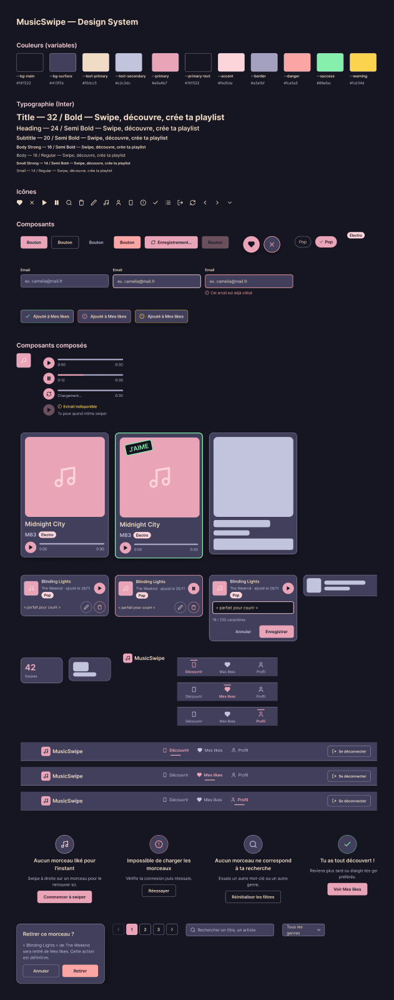
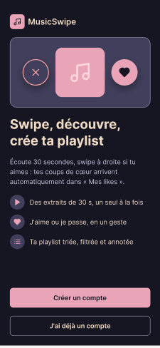
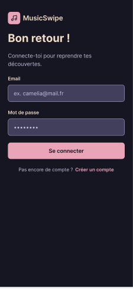
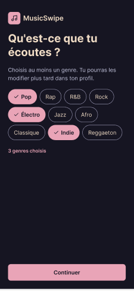
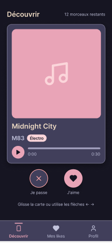
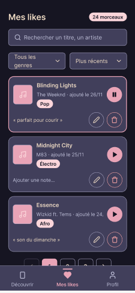
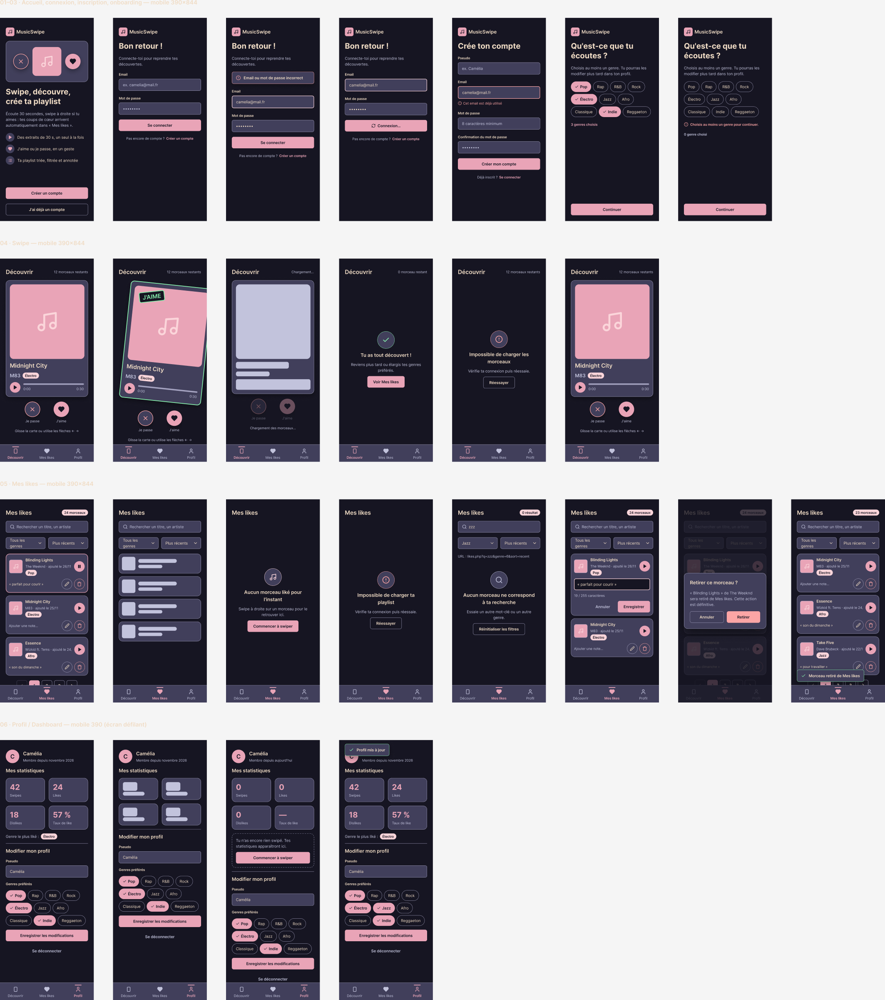

# DESIGN.md — MusicSwipe

> Fichier « à quoi ça ressemble ». Tous les tokens vivent dans `assets/css/tokens.css` ; aucun écran ne doit contenir de couleur hexadécimale en dur.

## 1. Principes directeurs
- **Mobile d'abord :** swipe pensé pour le pouce (390 px), puis élargi (768 px tablette, 1440 px desktop).
- **Mode sombre immersif :** fond très sombre, surfaces violettes, accents roses.
- **Lisibilité avant décoration :** la pochette et les boutons Cœur / Croix sont toujours visibles sans scroller sur mobile.
- **Jamais la couleur seule :** chaque statut porte un texte ou une icône avec libellé.

## 2. Design tokens (`assets/css/tokens.css`)

### Couleurs (contrastes calculés selon la formule WCAG 2.x)
| Token | Valeur | Usage | Contraste sur `--bg-main` | Contraste sur `--bg-surface` |
|---|---|---|---|---|
| `--bg-main` | `#161522` | Fond de page | — | — |
| `--bg-surface` | `#413f5b` | Cartes, header, modales, champs | 1,79 (bordure obligatoire) | — |
| `--text-primary` | `#f0dcc5` | Texte principal | 13,5:1 ✅ | 7,6:1 ✅ |
| `--text-secondary` | `#c2c3dc` | Texte secondaire, métadonnées | 10,4:1 ✅ | 5,8:1 ✅ |
| `--primary` | `#e9a4b7` | Bouton principal, Cœur, lien actif | 9,0:1 ✅ | 5,0:1 ✅ |
| `--primary-text` | `#161522` | Texte sur fond `--primary` / `--danger` | 9,0:1 sur primary ✅ | — |
| `--accent` | `#fbd5da` | Survol, focus, badge actif | 13,4:1 ✅ | 7,5:1 ✅ |
| `--border` | `#a3a1bf` | Bordures de champs et de cartes | 7,2:1 ✅ | 4,0:1 ✅ (≥ 3:1) |
| `--danger` | `#fca5a5` | Croix, Supprimer, messages d'erreur | 9,5:1 ✅ | 5,3:1 ✅ |
| `--success` | `#86efac` | Messages de succès | 12,8:1 ✅ | 7,2:1 ✅ |
| `--warning` | `#fcd34d` | Avertissements (extrait indisponible) | 12,5:1 ✅ | 7,0:1 ✅ |
| `--overlay` | `rgba(22, 21, 34, 0.8)` | Fond derrière les modales | — | — |
| `--primary-soft` | `rgba(233, 164, 183, 0.3)` | Fond des pochettes de remplacement | décoratif | décoratif |
| `--skeleton` | `rgba(194, 195, 220, 0.18)` | Blocs squelettes (état chargement) | décoratif | décoratif |
| `--border-subtle` | `rgba(163, 161, 191, 0.4)` | Séparateurs, bordure de la barre de navigation | décoratif | décoratif |
| `--veil` | `rgba(22, 21, 34, 0.75)` | Fond du tampon « J'AIME » pendant le glissement | — | — |

> Décision : l'ancien `--danger: #f87171` ne donnait que 3,6:1 sur `--bg-surface` (échec AA pour le texte) → remplacé par `#fca5a5` (voir `AI-LOG.md`).
> `--bg-surface` sur `--bg-main` = 1,79:1 : toute carte ou champ porte une bordure `1px solid var(--border)` pour rester repérable.

### Typographie
| Token | Valeur | Usage |
|---|---|---|
| `--font-family` | `'Inter', system-ui, -apple-system, sans-serif` | Tout le site |
| `--fs-sm` | `14px` | Métadonnées, aides de champ |
| `--fs-md` | `16px` | Corps de texte, champs (évite le zoom iOS) |
| `--fs-lg` | `20px` | Sous-titres, artiste sur la carte |
| `--fs-xl` | `24px` | Titre de carte / morceau |
| `--fs-2xl` | `32px` | Titre de page, compteurs du dashboard |
| `--fw-regular` / `--fw-semibold` / `--fw-bold` | `400` / `600` / `700` | Graisses |
| `--lh` | `1.5` | Hauteur de ligne du corps |

### Espacements, rayons, ombres, mouvement
| Token | Valeur |
|---|---|
| `--space-1` … `--space-7` | `4px`, `8px`, `12px`, `16px`, `24px`, `32px`, `48px` |
| `--radius-sm` | `8px` (champs, petits boutons) |
| `--radius-md` | `16px` (cartes, modales) |
| `--radius-full` | `9999px` (boutons ronds, pills) |
| `--shadow-card` | `0 8px 24px rgba(0, 0, 0, 0.35)` |
| `--shadow-modal` | `0 16px 48px rgba(0, 0, 0, 0.5)` |
| `--focus-ring` | `2px solid var(--accent)` + `outline-offset: 2px` |
| `--transition` | `200ms ease` (désactivée si `prefers-reduced-motion: reduce`) |

### Points de rupture (mobile-first, `min-width`)
- Base : 0–767 px (cible maquette 390 × 844)
- `768px` : tablette — liste en 2 colonnes possible
- `1024px` : desktop — navigation latérale ou header large, contenu centré `max-width: 1100px` (cible maquette 1440 × 900)

## 3. Composants
| Composant | Variantes | États | Tokens clés |
|---|---|---|---|
| **Button** | `primary`, `secondary` (contour), `ghost`, `danger` ; tailles `md` (44 px), `lg` (52 px) | hover, focus-visible, disabled, loading (« Enregistrement… » + spinner) | `--primary`, `--primary-text`, `--danger`, `--radius-sm` |
| **SwipeButton** | `like` (Cœur), `dislike` (Croix) — ronds 64 px, `aria-label` explicite | hover, active (scale 0.95), disabled pendant l'envoi | `--primary`, `--danger`, `--radius-full` |
| **TrackCard** (swipe) | — | normal, glissement (rotation + badge « J'AIME » / « JE PASSE »), skeleton | `--bg-surface`, `--radius-md`, `--shadow-card` |
| **AudioPlayer** | intégré à TrackCard et TrackRow | lecture, pause, chargement, erreur (« Extrait indisponible ») ; barre 0–30 s | `--primary`, `--border` |
| **TrackRow** (playlist) | — | normal, survol, lecture en cours, édition de note, skeleton | `--bg-surface`, `--border` |
| **GenrePill** | sélectionnable (onboarding, profil), filtre | inactif, actif (fond `--primary` + icône ✓), focus | `--radius-full` |
| **Input** | texte, email, mot de passe (afficher/masquer), recherche, textarea (note) | focus, erreur (bordure + message `--danger` sous le champ), disabled | `--border`, `--radius-sm` |
| **Select** | filtre genre, tri | focus, disabled | idem Input |
| **StatCard** | compteur du dashboard | normal, skeleton | `--fs-2xl`, `--bg-surface` |
| **Alert / Toast** | `success`, `error`, `warning` (icône + texte) | visible, fermé ; `role="status"` ou `role="alert"` | `--success`, `--danger`, `--warning` |
| **Modal** | confirmation de suppression | ouverte (focus piégé, Échap ferme), fermée | `--overlay`, `--shadow-modal` |
| **EmptyState** | avec / sans action | — | icône, message, Button |
| **Pagination** | précédent / numéros / suivant | page courante (`aria-current="page"`), disabled | `--primary` |
| **NavBar** | mobile : barre basse 3 onglets (Swipe, Mes likes, Profil) ; desktop : header | onglet actif (texte + soulignement, pas seulement la couleur) | `--bg-surface` |

## 4. États d'écran obligatoires
| Écran | Chargement | Vide | Erreur (+ Réessayer) | Succès | Aucun résultat |
|---|---|---|---|---|---|
| Connexion / Inscription | bouton « Connexion… » désactivé | — | message sous le champ / en tête de formulaire | redirection | — |
| Onboarding | bouton désactivé pendant l'envoi | — | « Choisis au moins un genre » | redirection vers Swipe | — |
| Swipe | skeleton de carte + audio « Chargement… » | « Tu as tout découvert ! » + liens | « Impossible de charger les morceaux » + Réessayer ; « Extrait indisponible » | carte suivante + mini-toast « Ajouté à Mes likes » | — |
| Mes likes | skeleton de 3 lignes | « Aucun morceau liké pour l'instant » + « Commencer à swiper » | message + Réessayer | toast « Note enregistrée » / « Morceau retiré » | « Aucun morceau ne correspond à ta recherche » + « Réinitialiser les filtres » |
| Profil / Dashboard | skeleton des StatCards | compteurs à 0 + « Commencer à swiper » | message + Réessayer | toast « Profil mis à jour » | — |

## 5. Accessibilité (WCAG AA)
- Contrastes : ≥ 4,5:1 texte normal, ≥ 3:1 grand texte et composants (vérifiés dans le tableau ci-dessus).
- Focus visible partout via `--focus-ring` ; ordre de tabulation logique.
- Zones tactiles ≥ 44 × 44 px (Cœur / Croix 64 px).
- Swipe : toujours une alternative boutons + clavier (← = je passe, → = j'aime, Espace = lecture/pause).
- Chaque champ a un `<label>` ; les erreurs sont reliées par `aria-describedby`.
- Images de pochette : `alt="Pochette de {titre} – {artiste}"`.
- Respect de `prefers-reduced-motion` (pas d'animation de rotation).
- `lang="fr"` sur `<html>`.

## 6. Maquettes Figma (`docs/screens/`)

### Cadres à créer
- Mobile : frame **390 × 844** (iPhone 14). Desktop : frame **1440 × 900**.
- Grille mobile : 4 colonnes, marges 16 px, gouttière 16 px. Desktop : 12 colonnes, marges 80 px, gouttière 24 px.
- Créer d'abord une page Figma « Design System » avec les styles de couleurs et textes nommés exactement comme les tokens (`bg-main`, `primary`…), puis les composants du §3.

### Écrans et états à dessiner
| # | Écran | Blocs (de haut en bas, mobile) | États à dessiner |
|---|---|---|---|
| 01 | Accueil | Logo + nom ; titre « Swipe, découvre, crée ta playlist » ; illustration / carte exemple ; 3 bénéfices (icône + texte) ; Button primary « Créer un compte » ; Button secondary « Se connecter » | rempli |
| 02 | Connexion / Inscription | Logo ; titre ; Inputs (pseudo, email, mot de passe, confirmation pour l'inscription) ; Button primary ; lien vers l'autre formulaire | rempli, erreur (champ en erreur + message), chargement (bouton désactivé) |
| 03 | Onboarding genres | Titre « Qu'est-ce que tu écoutes ? » ; sous-titre ; grille de 10 GenrePills (2 colonnes mobile) ; compteur « 3 genres choisis » ; Button primary « Continuer » collé en bas | rempli (3 actifs), erreur (aucun genre) |
| 04 | Swipe | NavBar ; TrackCard (pochette carrée ~340 px, titre, artiste, badge genre) ; AudioPlayer (play/pause + barre 0:00–0:30) ; SwipeButtons Croix / Cœur ; indication « ← je passe · j'aime → » | rempli, glissement (badge J'AIME), chargement (skeleton), vide (tout découvert), erreur (Réessayer + extrait indisponible) |
| 05 | Mes likes | NavBar ; titre + nombre de morceaux ; barre de recherche ; Select genre + Select tri ; liste de TrackRows (pochette 56 px, titre, artiste, badge genre, note, play, ✎, Retirer) ; Pagination | rempli, vide, chargement, erreur, aucun résultat, modale de suppression, édition de note |
| 06 | Profil / Dashboard | NavBar ; avatar initiale + pseudo ; 4 StatCards (Swipes, Likes, Dislikes, Taux de like) ; « Genre le plus liké » ; formulaire pseudo + GenrePills ; Button « Enregistrer » ; Button ghost « Se déconnecter » | rempli, vide (compteurs à 0), chargement, succès (toast) |

Desktop : mêmes blocs, NavBar en header, Swipe centré (carte max 420 px), Mes likes en tableau large avec filtres sur une ligne, Dashboard avec StatCards en 4 colonnes.

### Nommage des exports (PNG, x1)
Format : `NN-ecran-appareil-etat.png`, tout en minuscules, sans accent ni espace.
```
docs/screens/
├── 00-design-system.png
├── 01-accueil-mobile.png              01-accueil-desktop.png
├── 02-login-mobile.png                02-login-mobile-erreur.png
├── 02-register-mobile.png             02-login-desktop.png
├── 03-onboarding-mobile.png           03-onboarding-mobile-erreur.png
├── 04-swipe-mobile.png                04-swipe-mobile-glissement.png
├── 04-swipe-mobile-chargement.png     04-swipe-mobile-vide.png
├── 04-swipe-mobile-erreur.png         04-swipe-desktop.png
├── 05-likes-mobile.png                05-likes-mobile-vide.png
├── 05-likes-mobile-chargement.png     05-likes-mobile-erreur.png
├── 05-likes-mobile-aucun-resultat.png 05-likes-mobile-modale-suppression.png
├── 05-likes-desktop.png
├── 06-profil-mobile.png               06-profil-mobile-vide.png
└── 06-profil-desktop.png
```
Ajouter aussi le lien du fichier Figma (en lecture) dans le `README.md`.

### Fichier Figma
[MusicSwipe sur Figma](https://www.figma.com/design/6Li5ySI7w7VZokzkZHBZIb/MusicSwipe), 3 pages :
- **00 · Design System** : variables de couleur, rayons et espacements (collection « MusicSwipe tokens », noms identiques à `tokens.css`), 7 styles de texte, 2 ombres, 18 icônes, 18 composants (Button, SwipeButton, GenrePill, Badge, Input, Toast, Cover, AudioPlayer, TrackCard, TrackRow, StatCard, Logo, NavBar / Mobile, Header / Desktop, StateBlock, Modal, Pagination, SearchField, Select).
- **01 · Mobile (390×844)** : 25 écrans, chacun nommé comme son fichier d'export.
- **02 · Desktop (1440×900)** : *à faire* (le composant `Header / Desktop` est prêt).

> Les PNG actuels de `docs/screens/` ont été découpés dans une capture d'ensemble (≈ 225 px de large). Pour une meilleure netteté, sélectionner les cadres de la page 01 → Export PNG x2 → écraser les fichiers (les noms correspondent déjà).

### Références
| Écran | Rempli | États |
|---|---|---|
| Vue d'ensemble |  |  |
| Accueil |  | — |
| Connexion / Inscription |  | [erreur](docs/screens/02-login-mobile-erreur.png) · [chargement](docs/screens/02-login-mobile-chargement.png) · [inscription + erreur champ](docs/screens/02-register-mobile.png) |
| Onboarding |  | [erreur](docs/screens/03-onboarding-mobile-erreur.png) |
| Swipe |  | [glissement](docs/screens/04-swipe-mobile-glissement.png) · [chargement](docs/screens/04-swipe-mobile-chargement.png) · [vide](docs/screens/04-swipe-mobile-vide.png) · [erreur](docs/screens/04-swipe-mobile-erreur.png) · [extrait indisponible](docs/screens/04-swipe-mobile-erreur-audio.png) |
| Mes likes |  | [chargement](docs/screens/05-likes-mobile-chargement.png) · [vide](docs/screens/05-likes-mobile-vide.png) · [erreur](docs/screens/05-likes-mobile-erreur.png) · [aucun résultat](docs/screens/05-likes-mobile-aucun-resultat.png) · [édition note](docs/screens/05-likes-mobile-edition-note.png) · [modale suppression](docs/screens/05-likes-mobile-modale-suppression.png) · [succès](docs/screens/05-likes-mobile-succes.png) |
| Profil / Dashboard |  | [chargement](docs/screens/06-profil-mobile-chargement.png) · [vide](docs/screens/06-profil-mobile-vide.png) · [succès](docs/screens/06-profil-mobile-succes.png) |

**Desktop (à faire)** : mêmes blocs que le mobile, `Header / Desktop` en haut à la place de la NavBar, contenu centré `max-width: 1100px` ; Swipe : carte centrée (max 420 px) ; Mes likes : filtres sur une ligne + liste en 2 colonnes ; Profil : 4 StatCards sur une ligne, formulaire à droite.

**Défauts connus des maquettes** : sur `05-likes-mobile`, la pagination est partiellement masquée par la barre de navigation (le contenu défile en réalité) ; sur `06-profil-mobile-succes`, le toast recouvre l'avatar (en code, le placer en bas au-dessus de la NavBar).
