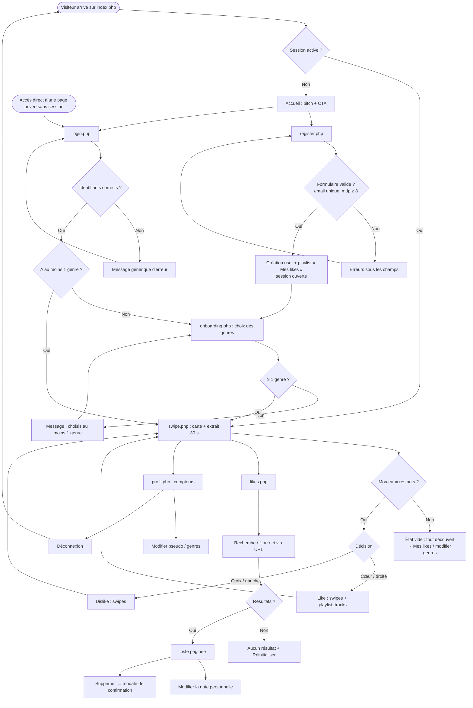

# PROJECT.md — MusicSwipe

> Fichier « quoi et pourquoi » du projet. Les règles techniques sont dans `AGENTS.md`, l'interface dans `DESIGN.md`, les décisions dans `AI-LOG.md`.

## 1. Pitch & proposition de valeur
**MusicSwipe** — *Swipe, découvre, crée ta playlist.*

Pour les étudiants et jeunes actifs qui veulent découvrir de nouveaux morceaux sans perdre de temps, **MusicSwipe** est une application web de découverte musicale par swipe qui crée automatiquement une playlist « Mes likes » avec les morceaux aimés.
Contrairement aux plateformes de streaming et à leurs menus complexes et playlists répétitives, MusicSwipe propose une décision simple en 30 secondes (j'aime / je passe) et garde chaque coup de cœur à portée de main, avec recherche, filtre et note personnelle.

## 2. Énoncé du problème
Les amateurs de musique qui utilisent les plateformes de streaming ont du mal à découvrir de nouveaux artistes rapidement, parce que les catalogues sont immenses et les playlists recommandées souvent répétitives, ce qui les pousse à réécouter toujours les mêmes morceaux et à oublier les titres découverts par hasard.

## 3. Persona
### Persona principal — Camélia
| Rubrique | Contenu |
|---|---|
| Identité | Camélia, 21 ans, étudiante en licence, écoute de la musique tous les jours. |
| Contexte d'usage | Smartphone dans les transports (sessions de 5 à 10 min, une main) ; ordinateur le soir en travaillant. |
| Objectifs | Trouver vite de nouveaux sons dans ses genres préférés et les retrouver facilement plus tard. |
| Frustrations | Catalogues infinis, recommandations qui tournent en rond, titres aimés oubliés faute de les avoir notés. |
| Citation | « Je veux juste écouter 30 secondes, swiper si j'aime, et retrouver mes coups de cœur sans me prendre la tête. » |

### Persona secondaire — Yanis
Yanis, 24 ans, jeune actif, utilise surtout la version desktop le soir pour faire le tri dans sa playlist (recherche, filtre par genre, notes personnelles). Il n'est pas prioritaire : le MVP est pensé mobile d'abord.

## 4. Périmètre MVP (MoSCoW)

### Must have — socle obligatoire
| # | Fonctionnalité | Exigence du socle couverte |
|---|---|---|
| M1 | Inscription, connexion, déconnexion, sessions PHP, redirection des pages privées vers `login.php` | Authentification |
| M2 | Onboarding : choix d'au moins 1 genre préféré | BDD + relation (`user_genres`) |
| M3 | Swipe like / dislike (glisser ou boutons Cœur / Croix) avec extrait audio 30 s | Cœur métier |
| M4 | Playlist « Mes likes » : liste, réécoute, **note personnelle modifiable**, suppression confirmée | CRUD complet |
| M5 | Recherche (titre/artiste) + filtre (genre) + tri + pagination, critères dans l'URL (`$_GET`) | Recherche / filtrage |
| M6 | Profil / Dashboard : compteurs réels + **modification du pseudo et des genres** | Espace personnel + Update |
| M7 | Responsive mobile-first, Design System (tokens CSS, WCAG AA), 4 états par écran | Responsive + Design System |
| M8 | Dépôt GitHub (1 ticket = 1 branche), déploiement public (hébergeur PHP/MySQL) | Git + Déploiement |

### Should have
- Exclusion des morceaux déjà swipés et priorité aux genres préférés dans la pile de swipe.
- Bouton « Annuler le dernier swipe » (uniquement le dernier, dans la session courante).

### Could have — bonus, uniquement quand le MVP est 100 % fonctionnel et déployé
- Alimentation du catalogue via l'API Deezer ou iTunes Search (gratuites, sans clé), avec mise en cache dans `tracks`.
- Avatar de profil (URL d'image).

### Won't have (this time) — Hors périmètre, NE PAS IMPLÉMENTER
- Aucune fonctionnalité sociale : amis, messagerie, partage de playlists, playlists collaboratives.
- Pas de profils publics ni de classements communautaires.
- Pas de blind test ni de découverte par humeur.
- Pas de paiement, pas d'abonnement.
- Pas de rôle administrateur ni de back-office de modération (le catalogue est alimenté par `database.sql`).
- Pas de lecture de morceaux complets (extraits de 30 s uniquement).
- Pas de réinitialisation de mot de passe par e-mail (nécessite un serveur d'envoi d'e-mails).
- Pas de playlists multiples créées par l'utilisateur (une seule playlist « Mes likes » par compte).

## 5. Couverture du socle (tableau de contrôle 20/20)
| Exigence | Comment MusicSwipe la couvre | Où le vérifier |
|---|---|---|
| Authentification | `register.php`, `login.php`, `logout.php`, `password_hash()` / `password_verify()`, `session_regenerate_id()` | Navigateur + table `users` |
| Pages privées | `includes/auth.php` inclus en tête de `onboarding.php`, `swipe.php`, `likes.php`, `profil.php` et de chaque `api/*.php` → redirection `login.php` (ou JSON 401) | Navigation privée sans session |
| ≥ 2 entités reliées | 7 tables : `users`, `genres`, `user_genres`, `tracks`, `swipes`, `playlists`, `playlist_tracks` (clés étrangères) | phpMyAdmin → Concepteur |
| **C**reate | Inscription ; swipe « like » → ligne dans `swipes` + `playlist_tracks` | phpMyAdmin |
| **R**ead | Pile de swipe ; liste « Mes likes » ; dashboard | Navigateur |
| **U**pdate | (1) Note personnelle d'un morceau liké (`playlist_tracks.personal_note`) ; (2) pseudo et genres préférés depuis `profil.php` | Navigateur + phpMyAdmin |
| **D**elete | Retirer un morceau de « Mes likes » après modale de confirmation | Navigateur + phpMyAdmin |
| Recherche + filtre + tri | `likes.php?q=…&genre=…&sort=…&page=…` (formulaire GET, critères conservés au rechargement) | URL + rechargement |
| Dashboard | `profil.php` : swipes, likes, dislikes, taux de like, genre le plus liké, genres préférés | Comparaison avec `COUNT(*)` dans phpMyAdmin |
| Responsive | Mobile-first 390 px → desktop 1440 px | DevTools mode appareil |
| Design System | `assets/css/tokens.css` + `DESIGN.md` (contrastes calculés AA) | Inspecteur CSS |
| Sécurité (équivalent RLS) | Toute requête filtre par `$_SESSION['user_id']`, PDO préparé, `htmlspecialchars`, jeton CSRF, double validation | Test 2 comptes (`AGENTS.md`) |
| Git | 1 ticket = 1 branche `feature/…`, commits clairs, merge dans `main` | `git log --oneline --graph` |
| Déploiement | Hébergeur gratuit PHP 8 + MySQL (ex. alwaysdata) — Vercel ne fait pas tourner PHP + MySQL | URL publique dans `README.md` |

## 6. Entités métier et relations (MySQL)
| Table | Rôle | Colonnes principales | Relations / contraintes |
|---|---|---|---|
| `users` | Compte utilisateur | `id`, `email` (unique), `password_hash`, `pseudo`, `avatar_url` (nullable), `created_at` | 1 user → 1 playlist, N swipes, N genres |
| `genres` | Catalogue des genres (10 en base) | `id`, `name` (unique) | — |
| `user_genres` | Genres préférés (N-N) | `user_id`, `genre_id` (PK composite) | FK → `users`, `genres` (CASCADE) |
| `tracks` | Catalogue de morceaux | `id`, `title`, `artist`, `cover_url`, `preview_url`, `genre_id`, `created_at` | FK → `genres` (RESTRICT) |
| `swipes` | Historique des décisions | `id`, `user_id`, `track_id`, `action` (`like`/`dislike`), `created_at` | UNIQUE (`user_id`, `track_id`) |
| `playlists` | Playlist « Mes likes » (créée à l'inscription) | `id`, `user_id`, `name`, `created_at` | FK → `users` (CASCADE) |
| `playlist_tracks` | Morceaux de la playlist (N-N) | `playlist_id`, `track_id`, `added_at`, **`personal_note` VARCHAR(255) NULL** *(à ajouter en T4)* | PK composite, FK CASCADE |

**Règles métier :**
- Un morceau n'est proposé qu'une fois par utilisateur (contrainte unique sur `swipes`).
- Retirer un morceau de « Mes likes » supprime la ligne de `playlist_tracks` mais **garde l'historique** dans `swipes` (le morceau n'est pas reproposé, les statistiques de swipe restent justes).
- Les compteurs du dashboard : *swipes* = `COUNT(swipes)`, *likes* = `COUNT(playlist_tracks)` de sa playlist, *dislikes* = `COUNT(swipes WHERE action='dislike')`.
- Un utilisateur sans genre préféré est redirigé vers `onboarding.php` après connexion.

## 7. Arborescence des écrans
| Route | Écran | Accès |
|---|---|---|
| `index.php` | Accueil / présentation | Public (redirige vers `swipe.php` si connecté) |
| `register.php` | Inscription | Public (redirige si connecté) |
| `login.php` | Connexion | Public (redirige si connecté) |
| `logout.php` | Déconnexion (POST + CSRF) → `index.php` | Privé |
| `onboarding.php` | Choix des genres | Privé |
| `swipe.php` | Découverte par swipe | Privé |
| `likes.php` | Playlist « Mes likes » (recherche, filtre, tri, note, suppression) | Privé |
| `profil.php` | Dashboard + modification pseudo / genres | Privé |

## 8. User flow

## 9. User stories (Must) & critères d'acceptation

### US-01 — Inscription
En tant que visiteur, je veux créer un compte afin de sauvegarder mes découvertes.
- **Nominal :** Étant donné que je ne suis pas connecté, quand je soumets un pseudo (2–30 caractères), un email valide et un mot de passe d'au moins 8 caractères identique à sa confirmation, alors mon compte est créé (mot de passe haché), ma playlist « Mes likes » est créée, ma session est ouverte et je suis redirigé vers `onboarding.php`.
- **Erreur :** Étant donné qu'un compte existe déjà avec cet email, quand je valide, alors le message « Cet email est déjà utilisé » s'affiche, mes saisies (sauf mot de passe) sont conservées et aucun doublon n'est créé.
- **Limite :** Étant donné que je contourne la validation HTML (champ vide envoyé), quand le serveur reçoit la requête, alors il refuse et réaffiche le formulaire avec l'erreur.

### US-02 — Connexion / déconnexion / pages protégées
En tant qu'utilisateur, je veux me connecter et me déconnecter afin d'accéder à mon espace en sécurité.
- **Nominal :** Étant donné un compte existant, quand je saisis les bons identifiants, alors je suis redirigé vers `swipe.php` (ou `onboarding.php` si je n'ai aucun genre).
- **Erreur :** Étant donné un mauvais mot de passe, quand je valide, alors le message générique « Email ou mot de passe incorrect » s'affiche (sans préciser lequel).
- **Protection :** Étant donné que je ne suis pas connecté, quand j'ouvre `swipe.php`, `likes.php`, `profil.php` ou `onboarding.php`, alors je suis redirigé vers `login.php`.
- **Déconnexion :** Étant donné que je suis connecté, quand je clique sur « Se déconnecter », alors ma session est détruite et le bouton « Précédent » ne redonne pas accès aux pages privées.

### US-03 — Onboarding des genres
En tant que nouvel utilisateur, je veux choisir mes genres préférés afin de recevoir des morceaux adaptés.
- **Nominal :** Étant donné que je suis sur l'onboarding, quand je sélectionne au moins un genre et valide, alors mes choix sont enregistrés dans `user_genres` et je suis redirigé vers `swipe.php`.
- **Erreur :** Étant donné que je ne sélectionne aucun genre, quand je valide, alors le message « Choisis au moins un genre » s'affiche (côté écran et côté serveur).
- **Limite :** Étant donné qu'un `genre_id` inexistant est envoyé, quand le serveur le reçoit, alors il est ignoré.

### US-04 — Swipe et écoute d'extrait
En tant qu'utilisateur connecté, je veux écouter un extrait de 30 s et swiper afin de trier mes découvertes.
- **Like :** Étant donné une carte affichée, quand je clique sur Cœur ou glisse à droite, alors un swipe `like` est enregistré, le morceau est ajouté à « Mes likes », l'audio s'arrête et la carte suivante s'affiche.
- **Dislike :** Étant donné une carte affichée, quand je clique sur Croix ou glisse à gauche, alors un swipe `dislike` est enregistré et la carte suivante s'affiche.
- **Vide :** Étant donné que j'ai swipé tous les morceaux, quand la pile est vide, alors l'état « Tu as tout découvert ! » s'affiche avec des liens vers « Mes likes » et « Modifier mes genres ».
- **Erreur audio :** Étant donné qu'un extrait ne charge pas, quand je lance la lecture, alors « Extrait indisponible » s'affiche et je peux quand même swiper.
- **Erreur réseau :** Étant donné que l'enregistrement du swipe échoue, alors la carte reste affichée avec un message et un bouton « Réessayer ».
- **Limite :** Étant donné que j'envoie deux fois le même swipe, alors une seule ligne existe en base (contrainte unique).

### US-05 — Consulter « Mes likes »
En tant qu'utilisateur connecté, je veux voir ma playlist afin de réécouter mes coups de cœur.
- **Nominal :** Étant donné que j'ai liké des morceaux, quand j'ouvre `likes.php`, alors je vois la liste (pochette, titre, artiste, genre, note, date d'ajout), du plus récent au plus ancien, 10 par page.
- **Vide :** Étant donné que je n'ai aucun like, alors « Aucun morceau liké pour l'instant » s'affiche avec le bouton « Commencer à swiper ».

### US-06 — Rechercher, filtrer, trier
En tant qu'utilisateur connecté, je veux rechercher et filtrer mes likes afin de retrouver un morceau rapidement.
- **Nominal :** Étant donné ma playlist, quand je tape « weeknd » et choisis le genre « Pop » puis le tri « Artiste A→Z », alors l'URL devient `likes.php?q=weeknd&genre=1&sort=artist` et la liste est filtrée.
- **Persistance :** Étant donné une URL avec critères, quand je recharge la page, alors les critères sont toujours appliqués et pré-remplis dans le formulaire.
- **Aucun résultat :** Étant donné une recherche sans correspondance, alors « Aucun morceau ne correspond à ta recherche » s'affiche avec « Réinitialiser les filtres ».
- **Limite :** Étant donné une valeur de `sort` ou `genre` invalide dans l'URL, alors le serveur applique la valeur par défaut sans erreur.

### US-07 — Modifier la note personnelle d'un morceau (Update)
En tant qu'utilisateur connecté, je veux ajouter ou modifier une note sur un morceau liké afin de me rappeler pourquoi je l'aime.
- **Nominal :** Étant donné un morceau de ma playlist, quand je saisis « parfait pour courir » et enregistre, alors la note est sauvegardée et un message « Note enregistrée » s'affiche.
- **Erreur :** Étant donné une note de plus de 255 caractères, alors elle est refusée côté écran et côté serveur.
- **Sécurité :** Étant donné que l'utilisateur B envoie une modification sur un morceau de la playlist de A, alors le serveur refuse (aucune ligne modifiée).

### US-08 — Retirer un morceau (Delete)
En tant qu'utilisateur connecté, je veux retirer un morceau de « Mes likes » afin de garder une playlist à jour.
- **Nominal :** Étant donné un morceau, quand je clique sur « Retirer » puis confirme dans la modale « Retirer *Blinding Lights* de Mes likes ? », alors il disparaît de la liste et de `playlist_tracks`, et un message de succès s'affiche.
- **Annulation :** Étant donné la modale ouverte, quand je clique sur « Annuler », alors rien n'est supprimé.
- **Sécurité :** Étant donné que B envoie une suppression ciblant la playlist de A, alors le serveur refuse et les données de A sont intactes.

### US-09 — Dashboard
En tant qu'utilisateur connecté, je veux voir mes statistiques afin de suivre mes découvertes.
- **Nominal :** Étant donné 3 likes et 2 dislikes, quand j'ouvre `profil.php`, alors je vois : 5 swipes, 3 likes, 2 dislikes, 60 % de taux de like, mon genre le plus liké et mes genres préférés.
- **Vide :** Étant donné un nouveau compte, alors les compteurs affichent 0 et un lien « Commencer à swiper ».
- **Isolation :** Étant donné le compte B, alors ses compteurs ne comptent jamais les données de A.

### US-10 — Modifier mon profil (Update)
En tant qu'utilisateur connecté, je veux modifier mon pseudo et mes genres préférés afin d'adapter mes découvertes.
- **Nominal :** Étant donné `profil.php`, quand je change mon pseudo et coche 2 nouveaux genres puis enregistre, alors `users.pseudo` et `user_genres` sont mis à jour et « Profil mis à jour » s'affiche.
- **Erreur :** Étant donné un pseudo vide ou aucun genre, alors le formulaire est refusé avec un message par champ.

## 10. Hypothèses et questions ouvertes
- Catalogue MVP : 8 morceaux de test avec extraits SoundHelix (pas de vrais extraits 30 s). Ajouter au moins 20 morceaux couvrant les 10 genres avant la démo pour tester pagination et filtres.
- Lecture limitée à 30 s côté JavaScript (les fichiers SoundHelix durent plusieurs minutes).
- Hébergement : à choisir parmi les hébergeurs gratuits PHP 8 + MySQL (alwaysdata recommandé).
